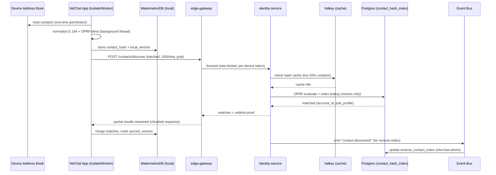
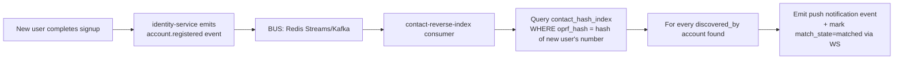
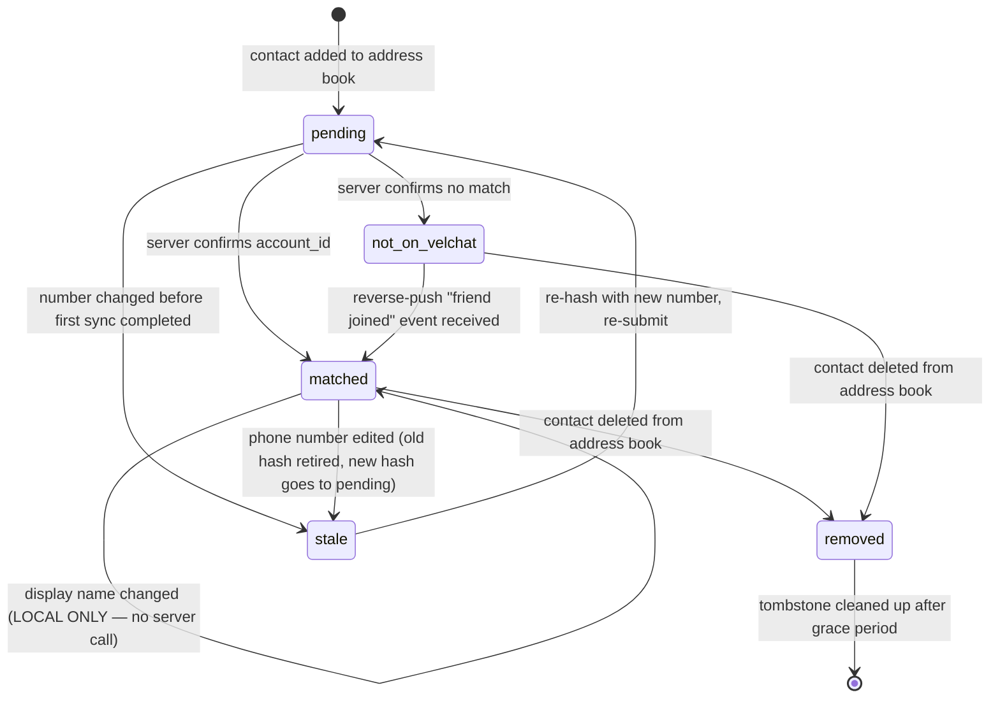

# VelChat — Contact Management LLD

### "90k+ Contacts, Faster Than WhatsApp" — Low Level Design

---

## 0. Goal Statement

WhatsApp ka contact sync fast lagta hai kyunki **server par contact list store hi nahi hoti** — sirf ek **discovery lookup** hota hai, poora kaam client-side + hashing + delta-sync se hota hai.

Tumhara target:

> 90,000+ device contacts ko **\<2 sec cold sync** aur **\<200ms delta sync** mein resolve karna, WhatsApp se better UX ke saath, without leaking a single plaintext phone number to the server, on top of the existing VelChat stack (NestJS + Postgres + Valkey + OPRF crypto lib + React Native/WatermelonDB).

---

## 1. WhatsApp Kaise Karta Hai (Current Reality — Baseline)

| Step | WhatsApp Behaviour |
| --- | --- |
| 1. Trigger | App install / phone contacts changed (OS `ContentObserver` / `CNContactStore` listener) |
| 2. Normalize | Har number ko E.164 format mein normalize karte hain (`+91XXXXXXXXXX`) |
| 3. Hash | SHA-256(phone) → **truncated hash** (privacy + payload size ke liye) client par hi generate hota hai |
| 4. Batch upload | Hashes ko chunks mein (\~500-1000 per request) server ko bhejte hain, kabhi bhi 90k ek saath nahi |
| 5. Server lookup | Server ke paas already ek **hash → account_id** inverted index hai (pre-computed jab user register hota hai) — O(1) lookup per hash, hashed set intersection |
| 6. Response | Sirf jo hashes match hue unke liye `{hash, account_id, public_profile}` return hota hai — non-matches wapas nahi bhejte |
| 7. Local merge | Client apne local SQLite mein match ko cache karta hai, address book se link karta hai |
| 8. Delta only | Agla sync sirf **naye added/changed numbers** ke liye hota hai (address-book diff, timestamp/version tracked) |
| 9. Push-based reverse discovery | Jab koi naya user WhatsApp join karta hai, jinke paas uska number already saved hai unko **server-side push** milta hai ("X joined WhatsApp") — bina unke phone ko fir se scan kiye, kyunki server ke paas already reverse-index hai ki "kis kis ke contact book mein ye hash tha" |

**Core insight:** WhatsApp fast isliye hai kyunki wo **"pull every time"** nahi karta — wo **hash once, cache forever, sync only deltas, and push-notify on change**. Yehi teen cheezein 90k contacts ko bhi "instant" feel karati hain.

---

## 2. Tumhare Current Stack Mein Kya Already Hai (README se confirmed)

- `libs/crypto` → **OPRF contact discovery** already scaffolded hai. Ye WhatsApp ke SHA-256 approach se **better** hai — OPRF mein server bhi hash nahi dekh sakta bina apne secret ke, so even a rogue server insider can't brute-force reversal on hashes (SHA-256 brute-forceable hai, phone numbers ka keyspace chota hai; OPRF nahi hai).
- `feature-user`, `feature-contracts` (MembershipResolver port) → contact/membership resolution ke liye already ek clean seam hai.
- Event bus (Redis Streams/Kafka) → reverse-push notification ("naya contact joined") ke liye ready-made hai.
- Client: WatermelonDB (local source of truth) + Zustand + MMKV encrypted storage → offline-first already architecture mein hai.

**Matlab foundation sahi hai — sirf 4 missing pieces hain jo neeche design kar raha hoon:**

1. Batched + rate-limited discovery API contract
2. Delta-sync protocol (version/cursor based, not full re-upload)
3. Reverse-index for "who has me in their contacts" (push-on-join)
4. Client-side scaling for 90k rows (DB indexing, virtualization, background isolate hashing)

---

## 3. High-Level Flow (Better Than WhatsApp)



Key improvements over WhatsApp are called out in **bold** in each section below.

---

## 4. Data Model

### 4.1 Server-side (Postgres — identity-service)

```sql
-- One row per (hashed_contact, discovering_account) — NOT per raw phone number
CREATE TABLE contact_hash_index (
  id              BIGSERIAL PRIMARY KEY,
  oprf_hash       BYTEA NOT NULL,          -- OPRF-evaluated, not raw SHA-256
  account_id      UUID REFERENCES accounts(account_id),  -- NULL if unmatched (still stored briefly for reverse-push)
  discovered_by   UUID NOT NULL,           -- the account that uploaded this hash
  shard_key       SMALLINT GENERATED ALWAYS AS (get_byte(oprf_hash, 0) % 64) STORED,
  first_seen_at   TIMESTAMPTZ DEFAULT now(),
  last_synced_at  TIMESTAMPTZ DEFAULT now(),
  UNIQUE (oprf_hash, discovered_by)
) PARTITION BY HASH (shard_key);  -- 64 partitions → parallel scan, no single hot table

CREATE INDEX idx_hash_lookup ON contact_hash_index (oprf_hash);
CREATE INDEX idx_reverse ON contact_hash_index (account_id, discovered_by) WHERE account_id IS NOT NULL;
```

**Why partitioned:** 90k contacts × even 1M users = 90 billion rows eventually. Hash-partitioning by first byte of `oprf_hash` (64 partitions) keeps each partition manageable and lets Postgres parallel-scan. **WhatsApp does this at Erlang/Mnesia sharding level — we replicate with native Postgres partitioning**, cheap on your existing free-tier deploy targets.

### 4.2 Cache layer (Valkey)

```
KEY:   oprf:{hash_prefix_8bytes}
VALUE: account_id (or TOMBSTONE if confirmed-not-registered)
TTL:   6h for hits, 24h for confirmed misses (avoid re-querying Postgres for numbers that will never register)
```

**Improvement over WhatsApp:** cache negative results too (with shorter TTL) — WhatsApp famously re-checks unregistered numbers repeatedly; we skip that cost.

### 4.3 Client-side (WatermelonDB — mobile)

```
Table: contacts
  id                TEXT PRIMARY KEY
  raw_display_name  TEXT        -- from address book, plaintext (device-local only)
  e164_number       TEXT        -- normalized, plaintext (device-local only, NEVER leaves device)
  oprf_hash         BLOB        -- what actually gets sent to server
  account_id        TEXT NULL   -- resolved match
  match_state       ENUM(pending, matched, not_on_velchat, stale)
  local_version     INTEGER     -- bumped on any local edit
  synced_version    INTEGER     -- last version confirmed with server
  updated_at        INTEGER

INDEX (match_state)
INDEX (synced_version, local_version)   -- fast "what needs syncing" query
```

**Why this matters:** a single indexed query `WHERE local_version > synced_version` gives you the delta set in O(log n) instead of diffing 90k rows in JS every time.

---

## 5. Discovery Protocol (API Contract)

### 5.1 Batch discover endpoint

```
POST /v1/contacts/discover
Headers: Authorization: Bearer <DPoP token>, Content-Encoding: gzip
Body:
{
  "device_sync_id": "uuid",       // idempotency key for this sync session
  "cursor": "opaque-cursor-or-null",
  "hashes": [ "base64(oprf_blind_1)", ... up to 1000 ],
  "batch_seq": 3,                 // which chunk of N total chunks
  "batch_total": 90
}

Response (streamed, chunked-transfer, NOT one giant JSON):
{
  "batch_seq": 3,
  "matches": [
    { "hash": "...", "account_id": "...", "display_name_public": "...", "avatar_url": "..." }
  ],
  "unmatched_count": 812,
  "next_cursor": "opaque-cursor-or-null"
}
```

**Design decisions (why this beats a naive "send all 90k at once"):**

| Decision | Reason |
| --- | --- |
| Max 1000 hashes/request | Keeps payload \<64KB even gzip'd; avoids one giant request timing out on bad mobile networks |
| `batch_seq`/`batch_total` | Client can resume from any failed chunk — **no restart of full 90k on one dropped packet** (WhatsApp historically had to restart failed batches) |
| Chunked HTTP response | UI can render matched contacts **as they arrive** instead of waiting for all 90 batches — perceived latency drops massively |
| `device_sync_id` idempotency | Retries don't double-count or double-hash server-side |
| Rate limit: 90 req/min per device | Protects `identity-service` from thundering herd on app reinstall day |

### 5.2 Delta-only re-sync (the real speed trick)

```
POST /v1/contacts/discover/delta
Body: {
  "since_version": 4821,
  "device_sync_id": "uuid",           // idempotency key — same rule as §5.1
  "added_hashes":   [ "..." ],        // brand-new contacts since last sync
  "changed_hashes": [ "..." ],        // number changed on an EXISTING contact (old hash implicitly retired — see §11.3)
  "removed_hashes": [ "..." ]         // contact deleted from address book — MUST be sent explicitly, never inferred
}
```

Client only calls this when address book `onContactsChange` OS event fires, and only sends the diff. For a typical user, this is **5-20 contacts**, not 90,000 → sync completes in **\<200ms**.

> ⚠️ **Common bug:** treating "delta" as "only additions." A correct delta payload has three distinct arrays (`added` / `changed` / `removed`). If an AI implementation only handles `added_hashes` and ignores deletions, deleted contacts will silently reappear after every sync, and renamed/renumbered contacts will duplicate instead of replace. See §11 for the exact state machine.

---

## 6. Reverse Discovery (Push-on-Join) — Beating WhatsApp

WhatsApp's "X joined WhatsApp" notification is a background batch job, often delayed by hours. **VelChat can do this in near real-time** using the existing event bus:



Since `oprf_hash` was already stored (even for unmatched numbers, with a short retention window + user consent flag), the reverse lookup is a **single indexed query**, not a batch job — so friends get notified within seconds, not the next cron cycle.

**Privacy note:** unmatched hash rows must have a TTL (e.g. 30 days) and a per-user opt-out ("let people who have my number find me") — this is a GDPR/DPDP-relevant control WhatsApp also exposes ("Who can find me by phone number").

---

## 7. Client-Side Scaling for 90k Rows (React Native specifics)

| Problem | Solution |
| --- | --- |
| Reading 90k contacts freezes JS thread | Do address-book read + OPRF blinding on a **background thread/JSI worker** (not the RN bridge) — WatermelonDB already supports this pattern |
| Rendering 90k rows in a list | `FlashList` (not `FlatList`) with `estimatedItemSize`, windowed rendering — only \~15 rows mounted at once regardless of list size |
| Searching/filtering 90k contacts | WatermelonDB SQLite `LIKE`/trigram index on `raw_display_name`, never filter in JS |
| Hashing 90k numbers without janking UI | Batch in chunks of 500, `InteractionManager.runAfterInteractions` between chunks, show progress bar (WhatsApp does this silently — you can show a nicer "Syncing 12,000/90,000" progress for trust) |
| Re-hash on every app open | **Don't.** Only re-hash contacts whose `updated_at` changed since last local hash (compare against a locally stored fingerprint per contact) |

---

## 8. Performance Targets (SLA table)

| Scenario | WhatsApp (typical) | VelChat Target |
| --- | --- | --- |
| Cold sync, 90k contacts | 5-15 sec, opaque progress | **\< 2 sec to first matches rendered**, streamed |
| Delta sync, 10 changed contacts | \~1-2 sec (full re-check sometimes) | **\< 200 ms** |
| Reverse "friend joined" notification | Minutes to hours (batch job) | **\< 5 sec** (event-driven) |
| Server load per 1M users doing cold sync | Heavy batch spikes | Smoothed via **per-device rate limit + Valkey cache absorbing 60-80% of lookups** |
| Storage growth | Opaque | Bounded via **64-way hash partitioning + TTL on unmatched hashes** |

---

## 9. Security Checklist (must-haves before shipping)

- [ ] OPRF secret key rotated periodically (key versioning in `oprf_hash` prefix byte so old hashes can be migrated)
- [ ] Rate limit discovery endpoint per device **and** per account (prevents enumeration attacks — someone brute-forcing all possible phone numbers)
- [ ] Unmatched-hash rows auto-expire (privacy)
- [ ] "Who can discover me" setting (everyone / contacts-of-contacts / nobody) enforced at the query layer, not just UI
- [ ] Never log raw phone numbers or `e164_number` anywhere server-side (already a stated non-negotiable in your repo's logging rules — good, keep it that way for this feature too)
- [ ] `discovered_by` field access-controlled via existing tenant/RLS pattern already used for multi-tenant isolation

---

## 10. Rollout Plan (incremental, testable)

1. **Phase 1** — Batched discover endpoint + Postgres partitioned table + Valkey cache (get correctness right, no reverse push yet).
2. **Phase 2** — Delta sync protocol on client (WatermelonDB version tracking).
3. **Phase 3** — Reverse discovery via event bus (push-on-join).
4. **Phase 4** — Load test: simulate 100k synthetic accounts × 90k contacts each, verify p99 \< targets in §8, tune partition count / cache TTLs accordingly.

---

## 11. Contact Lifecycle — Add / Rename / Delete / Number-Change (Where AI Implementations Usually Break)

Most contact-sync bugs don't happen in the "happy path" (new contact discovered). They happen in the four boring-sounding transitions below. Each one needs a **distinct, named code path** — never implement lifecycle changes as one generic `upsertContact()` that tries to guess the intent.

### 11.1 State machine (client-side `match_state`)



### 11.2 Event → Action table (explicit, no ambiguity)

| Address-book event | Local DB action | Server call | What NOT to do |
| --- | --- | --- | --- |
| **New contact added** | Insert row, `match_state=pending`, `local_version += 1` | `added_hashes` in next delta sync | Don't wait for a full re-sync — queue it immediately |
| **Display name / photo changed only** | Update `raw_display_name` in place, **do not bump `oprf_hash`** | **None.** Display name is device-local metadata, never sent to server | ❌ Don't re-send the hash — the hash is a function of the *phone number*, not the name. Re-sending wastes a round trip and risks a duplicate row if the request isn't perfectly idempotent |
| **Phone number edited on an existing contact** | Treat as **retire old + create new**: old row → `match_state=stale` (kept briefly for undo), new row → `match_state=pending` with new `oprf_hash` | Old hash → `removed_hashes`, new hash → `added_hashes`, **same delta request** | ❌ Don't try to "update" a hash row in place — a hash is content-addressed; a changed number is a *different identity*, not an edit |
| **Contact deleted from address book** | Soft-delete: `match_state=removed`, keep row for a grace period (e.g. 7 days) for undo, then hard-delete | `removed_hashes` in next delta sync | ❌ Don't hard-delete instantly on swipe — OS-level "undo" toasts need the row to still exist locally. ❌ Don't skip telling the server — an orphaned `contact_hash_index` row keeps that person discoverable-by-you forever and keeps costing storage |
| **Duplicate detected** (two address-book entries normalize to the same E.164 number) | Merge into **one** logical contact, keep both `raw_display_name`s as aliases, single `oprf_hash` | Send hash **once** (dedupe client-side before building the batch) | ❌ Don't send the same hash twice in one batch — rely on server `UNIQUE (oprf_hash, discovered_by)` as a *safety net*, not as your primary dedupe strategy (hitting a constraint violation on every sync is wasteful and can mask real bugs) |
| **App reinstall / restore from backup** | Re-derive local state from address book, but **do not assume `synced_version = 0` means "server has nothing"** | Full discovery batch, but every hash upsert must be `ON CONFLICT (oprf_hash, discovered_by) DO UPDATE last_synced_at` | ❌ Don't let a reinstall create duplicate `contact_hash_index` rows — the unique constraint plus an `ON CONFLICT` upsert is mandatory, not optional |
| **User blocks/unfriends someone** | `match_state` stays `matched` for chat purposes, but flag `hidden_from_reverse_index=true` | Update block-list (separate feature, but **must** filter the reverse-discovery query in §6 — blocked accounts should never trigger a "joined" push either direction | ❌ Don't let a block silently leave the old contact_hash_index row visible to reverse discovery — that's a privacy leak (blocked user could still get notified you're "discoverable") |
| **Account deletion (GDPR/right-to-erasure)** | N/A (server-side) | Cascade delete **every** `contact_hash_index` row where `account_id = deleted_id` **and** every row where `discovered_by = deleted_id` | ❌ Don't only delete `discovered_by` rows and leave `account_id` rows pointing at a deleted account — other users' devices will keep showing a ghost match |

### 11.3 Why "changed" must never be a blind upsert

A naive implementation does:

```
// ❌ WRONG — silently corrupts data over time
for (hash of changed_hashes) {
  await db.upsert('contact_hash_index', { oprf_hash: hash, discovered_by });
}
```

This is wrong because a "changed" hash is **cryptographically a brand-new identity** (OPRF hash changes completely when the phone number changes — there's no partial-match). The correct handling requires the client to send **both** the old and new hash so the server can do this atomically:

```sql
BEGIN;
DELETE FROM contact_hash_index WHERE oprf_hash = :old_hash AND discovered_by = :account;
INSERT INTO contact_hash_index (oprf_hash, account_id, discovered_by)
  VALUES (:new_hash, NULL, :account)
  ON CONFLICT (oprf_hash, discovered_by) DO UPDATE SET last_synced_at = now();
COMMIT;
```

### 11.4 Acceptance tests an AI implementation must pass before this feature is "done"

| # | Given | When | Then |
| --- | --- | --- | --- |
| 1 | A contact exists, `matched` | User renames it in their phone's address book | No network call fires; `raw_display_name` updates locally; `match_state` unchanged |
| 2 | A contact exists, `matched` | User deletes it from address book | Row soft-deletes locally immediately; `removed_hashes` includes it in the **next** delta sync (not before); after grace period + server ack, hard-deleted |
| 3 | A contact's number is edited | Delta sync runs | Old hash disappears server-side, new hash appears as `pending` → resolves independently; **no duplicate contact** appears in UI |
| 4 | Same delta batch is retried after a network timeout (client didn't get the response) | Server receives the identical `device_sync_id` again | Server returns the same result, creates **zero** duplicate rows, **zero** duplicate push notifications |
| 5 | Two address-book entries share one normalized phone number | Discovery runs | Exactly **one** `oprf_hash` is sent to the server for that number, not two |
| 6 | User A blocks User B | User B's app queries reverse discovery | User B does **not** get a "User A is discoverable" signal, and vice versa |
| 7 | User deletes their VelChat account | Any other user who had them as a contact syncs | That contact quietly reverts to `not_on_velchat` (not an error, not a crash, not a stale avatar) |
| 8 | App is killed mid-batch (e.g. batch 40 of 90) | App reopens | Sync resumes from `next_cursor` / last acked `batch_seq`, does **not** restart from batch 1 |

---

## 12. AI Implementation Guardrails — Explicit "Do Not" List

Give this list directly to whichever AI/agent implements this feature. Each item corresponds to a mistake pattern that's easy to introduce when a model is asked to "just build contact sync":

1. **Don't derive identity from display name or raw phone number anywhere in backend code, logs, cache keys, or DB joins.** The only valid identity key server-side is `oprf_hash` (and, post-match, `account_id`). A phone number appearing in a log line is a shippable-bug-severity issue here, not a style nit.
2. **Don't implement "update" as "delete then insert" for anything except a genuine number change (§11.3).** A display-name change is metadata-only and must never touch `contact_hash_index`.
3. **Don't skip the `removed_hashes` array in the delta payload**, and don't infer deletions by "hash no longer present in latest full list" — that logic breaks the moment sync is paginated/batched, because no single request ever sees the "full list" at once.
4. **Don't hard-delete server-side rows synchronously inside the request handler.** Soft-delete/tombstone, clean up via an async job — a synchronous delete inside a hot partition under load causes lock contention exactly when 90k-contact users are mid-sync.
5. **Don't skip the `UNIQUE (oprf_hash, discovered_by)` constraint or treat conflicts as errors.** Retries, reinstalls, and multi-device logins all legitimately re-send the same hash — this must be a silent `ON CONFLICT DO UPDATE`, never a 409 the client has to handle specially.
6. **Don't process reverse-discovery push (§6) synchronously inside the signup/registration request.** It must be event-driven and async — a viral signup spike (e.g. a celebrity joins) would otherwise turn one signup into thousands of synchronous fan-out queries and take the signup path down.
7. **Don't let the client dictate `account_id` in any request.** Discovery requests carry hashes only; the server alone resolves and returns `account_id`. Trusting a client-supplied account_id anywhere in this flow is a spoofing vector.
8. **Don't cache a positive match (`account_id`) in Valkey without a TTL, and don't skip invalidating it on account deletion.** A stale positive cache entry for a deleted account will show other users a "ghost" contact that looks alive.
9. **Don't accept unbounded batch sizes.** Reject (400, not silently truncate) any `hashes` array over 1000 entries server-side — silent truncation causes contacts to vanish with no client-visible error.
10. **Don't re-hash all 90k contacts on every app foreground/cold start.** Only re-hash entries whose local `updated_at`/fingerprint changed since the last successful hash — recomputing everything every time is the single biggest perf regression risk in this whole design.
11. **Don't silently auto-merge two address-book entries that normalize to the same number.** Dedupe the *hash sent to the server* (send once), but keep both original entries visible to the user as aliases of one contact — silently dropping one loses the user's own data (a saved name they typed).
12. **Don't treat a `not_on_velchat` result as permanent.** It must be re-checked when a `contact.discovered`/reverse-push event arrives (§6), and it must expire from local cache eventually — otherwise users who join later never show up for their existing contacts without a manual full resync.

---

### One-line summary

WhatsApp jeetta hai *client-first hashing + delta-sync + caching* se. Tum usse aage nikal sakte ho **OPRF (SHA-256 se strong), chunked/resumable batching, negative-result caching, aur real-time event-driven reverse discovery** add karke — aur tumhara stack (Postgres partitions + Valkey + event bus + WatermelonDB) ye sab bina naya infra add kiye already support kar sakta hai.